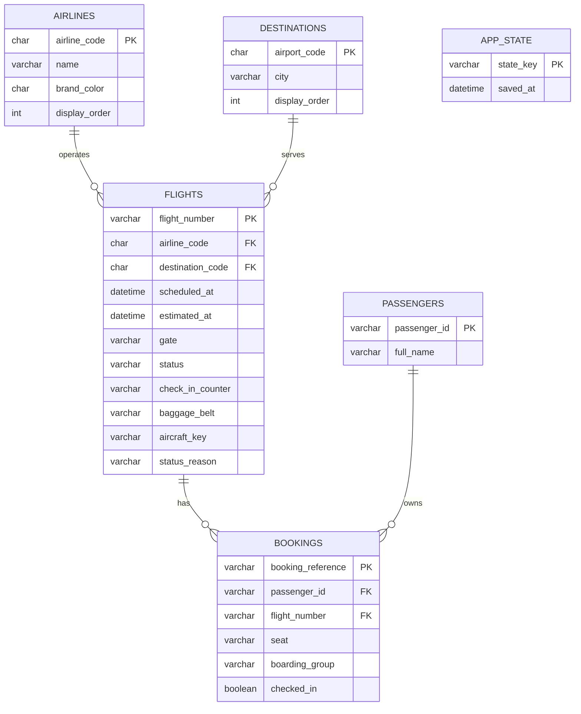

# Skyscope project and database map

## Project map

```text
JavaFX screens (ui)
        ↓ user actions
FidsController
        ↓ calls business operations
FlightService (validation, simulation events, undo, audit)
        ↓ FlightDataSource interface
MySqlDataSource ── JDBC ── MySQL database: skyscope
        ↑ first launch only
JsonDataSource migration ← data/fids.json, or seed.json if no saved file exists
```

| Project area | Responsibility | Main files |
|---|---|---|
| `model` | Flight, aircraft, passenger, booking and status rules | `Flight.java`, `Booking.java`, `FlightDataSource.java`, `SampleData.java` |
| `service` | Business rules, gate checks, check-in, simulation, undo and audit | `FlightService.java`, `SimulationService.java`, `service/command/` |
| `data` | Storage adapters | `MySqlDataSource.java` (normal storage), `JsonDataSource.java` (one-time migration) |
| `ui` | JavaFX screens and event coordination | `FidsController.java`, `AdminView.java`, `BoardView.java`, `LookupView.java` |
| `database` | MySQL schema setup | `schema.sql` |
| `docs` | Project explanation and demo guidance | `OVERVIEW.md`, `UML.md`, `DEMO.md`, this file |

## Database relationships



The schema keeps airline and destination details once, then references them from each flight. A passenger can have
several bookings; each booking points to one passenger and one flight. `app_state` stores the timestamp of the last
saved snapshot so estimated and scheduled times keep moving forward when the app restarts.

## Existing information and first launch

1. Run `database/schema.sql` in MySQL. It creates the `skyscope` database and all six tables.
2. Start the app. If the database has no flights, it imports the existing `data/fids.json` snapshot when present.
   This keeps flight status, gate, scheduled and estimated times, delay/cancellation reason, booking, passenger,
   and checked-in state. If there is no saved JSON file, it loads the existing 12-airline, 24-destination,
   22-flight and 6-booking demo set from `src/main/resources/data/seed.json`.
3. The imported snapshot and catalog are written as one MySQL transaction. Later changes save to MySQL; the old
   JSON file is left in place as a backup and is not read again once MySQL contains flights.

The migration uses the same saved-time offset as the old JSON source. It reads a legacy snapshot without applying
the old “all flights are inactive” demo reset, so its data reaches MySQL intact. The regular JSON source retains its
original behavior for its existing tests and for anyone using it directly.

## MySQL setup

Use MySQL 8.0 or newer. Run the script from a MySQL client:

```sql
SOURCE C:/path/to/airplane-management-system/database/schema.sql;
```

By default the app connects to `jdbc:mysql://localhost:3306/skyscope` as `root` with an empty password, which works
for a basic local demo install. Override these with environment variables for another account:

```powershell
$env:SKYSCOPE_DB_URL = 'jdbc:mysql://localhost:3306/skyscope?useSSL=false&allowPublicKeyRetrieval=true&serverTimezone=Africa/Nairobi'
$env:SKYSCOPE_DB_USER = 'your_mysql_user'
$env:SKYSCOPE_DB_PASSWORD = 'your_mysql_password'
mvnw.cmd javafx:run
```

If MySQL is unavailable, the existing demo fallback starts in memory and prints a warning to the console; that
session does not persist changes. When MySQL is ready, restart the app to use the database.
