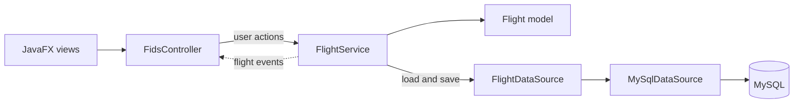

# Brian — Architecture & OOP

**Time:** 2–3 minutes · **Goal:** explain how the layers work together, then use one file to illustrate OOP.

## Explain the architecture flow

Start at the screen: a passenger searches or staff changes a gate. The view sends that action to FidsController, which calls FlightService. The service applies the business rules and changes the model. For storage, it uses the FlightDataSource interface; MySqlDataSource handles the SQL work.

The dotted arrow is the Observer path. After a successful change, FlightService sends an event to the controller. The controller refreshes the views and shows a notification when appropriate.

**Say:** “The screen handles presentation, the controller coordinates, and the service owns the rules. Keeping those jobs separate means the flight rules do not have to live inside every screen.”

## Use one file for the OOP explanation

Open **src/main/java/com/example/airplane/model/Aircraft.java**. Show lines **9–13**, **29–32**, and **47–56**.

- **Encapsulation:** the aircraft’s shared fields are private and final, so other classes cannot change them directly.
- **Abstraction:** Aircraft is abstract. It describes what every aircraft has and which behaviors each type must provide.
- **Inheritance:** NarrowBody, RegionalJet, and WideBody extend Aircraft. The factory shown in this file creates the appropriate subtype.
- **Polymorphism:** each subtype implements category and cabinCrew for its own aircraft type. The caller can use the Aircraft type and get the right behavior from the actual subtype.

**Say:** “Aircraft keeps shared details private and defines the behavior all aircraft types must provide. The factory creates a particular subtype; when the program asks for its category or crew requirement, that subtype gives the answer.”

The actual extends declarations are in the subtype files. Name that relationship without opening another file during this short explanation.

## Link the patterns to what the audience saw

- **Observer:** after a flight changes, FlightService sends an event; FidsController receives it, refreshes the board, and shows a notification when needed.
- **Strategy:** staff can switch Demo and Realistic behavior at runtime. SimulationService calls the same strategy interface in either mode.
- **Command + Memento:** each staff action is a command object. Flight commands keep snapshots so Undo can restore earlier values; undoing a newly added flight removes it.
- **Factory:** Aircraft.of selects the concrete aircraft subtype from its key, so callers do not construct each subtype themselves.
- **Presenter-style UI:** FidsController handles actions and refreshes the views. This is MVP-inspired separation, not a formal MVC framework.

**Handoff:** “Those layers and patterns keep the passenger and staff features connected without mixing their responsibilities. Wendy will show where the flight and booking data is saved.”
