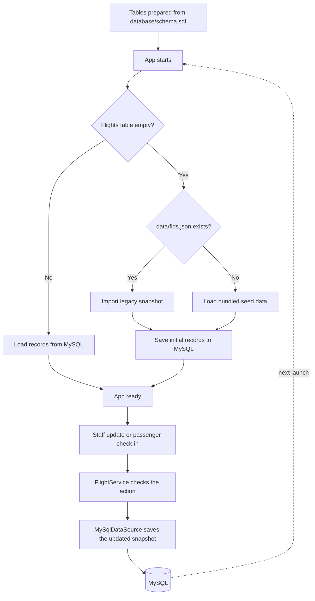

# Wendy — Database Walkthrough

**Time:** about 2–3 minutes · **Focus:** trace one passenger or staff change from the app to MySQL and explain what happens when the app starts again.

## What to say

### 1. Start at the top of the diagram

> “This diagram shows how SkyScope uses MySQL. The database tables have to be prepared before the app starts; the app does not create missing tables by itself. Once it starts, it checks whether the flights table already has data.”

### 2. Explain the two startup paths

Point to the Yes and No branches.

> “If flights are already in MySQL, the app loads the existing flights, bookings, and reference data. If the flights table is empty, it looks for the older data/fids.json file. When that file is available, it imports that saved snapshot. If it is not available, the app uses the bundled sample data and saves it to MySQL. After this first load, MySQL becomes the normal source for the app.”

**Presenter note:** the current project includes data/fids.json, so a clean database will use that migration path. The bundled seed file is the fallback when the old file is absent.

### 3. Explain the storage design and relationships

> “The screens do not write to the database directly. FlightService uses a common storage interface, and MySqlDataSource handles the MySQL work. There is also an in-memory fallback if MySQL is unavailable, but changes in that fallback session do not persist.”

> “The tables are connected by their relationships. Airlines and destinations are stored once and referenced by flights. A booking connects one passenger to one flight and stores the seat, boarding group, and check-in state. Foreign keys keep those links valid, and the database prevents the same seat being booked twice on one flight.”

Point out the app_state node in the database design if asked: it records when the last snapshot was saved, so the app can advance flight times after a restart.

### 4. Trace one update through the bottom of the diagram

Use the check-in that Njeri just demonstrated, or a staff gate change.

> “When the passenger checks in, the screen sends that request through the controller to FlightService. The service checks that check-in is still open, then updates the booking. MySqlDataSource saves the updated snapshot in a database transaction. When the save is complete, the controller refreshes the screen. If the database write fails partway through, the transaction rolls back rather than leaving a partial snapshot.”

> “For this check-in, the booking’s checked-in value is saved. For a gate change or delay, the flight’s gate, status, estimated time, and reason are saved.”

If MySQL Workbench is already open, point to the BK7F3A booking row and its checked-in value, or to the flight row after a staff update. No query is needed.

### 5. Close with restart and test evidence

> “On the next launch, the app reads the saved records from MySQL. It uses the saved timestamp to keep scheduled and estimated times moving forward. Flight and booking changes persist; the staff undo history and audit log are for the current session.”

> “We have 65 JUnit tests covering core rules, service behavior, edge cases, notifications, and the JSON data source. The live MySQL connection is best demonstrated by showing the saved row; it does not have a dedicated integration test in this suite.”

**If the database is unavailable:** the app can still open with sample data in memory, but do not describe that session as persistent.
