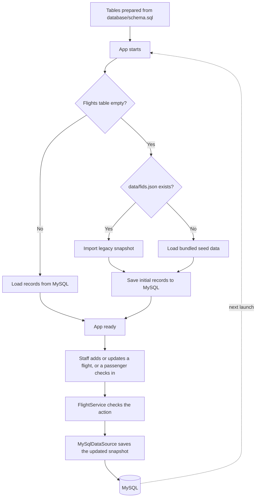
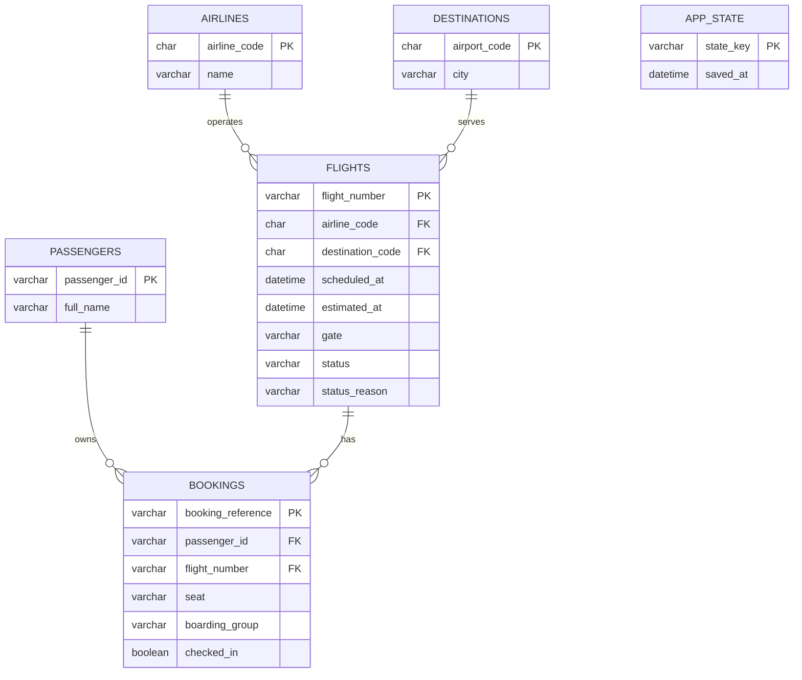

# Wendy — Database Walkthrough

**Time:** about 3 minutes · **Goal:** show where flight data lives, how app changes are saved, and what comes back on restart.

## Diagram 1: app startup and persistence

### What to say

> “Start at the top. The MySQL tables must already be prepared; the app does not create missing tables. On launch, the app checks whether flights are already stored. If they are, it loads the existing records. If the flights table is empty, it imports data/fids.json when that legacy file is present. If not, it loads the bundled seed data and saves it to MySQL. After that first load, MySQL is the app’s normal source.”

**Presenter cue:** the current project contains data/fids.json, so a clean database uses the legacy import path. The bundled seed is the fallback if that file is absent.

> “The service does not put SQL in the screens. It uses FlightDataSource as the storage interface, and MySqlDataSource handles the normal MySQL reads and writes. The JSON source is only for the old-data import; the in-memory source is a fallback if MySQL is not available.”

## Diagram 2: how the database tables relate

### What to say

> “This diagram shows where the records are kept. Airline and destination details are stored once, and each flight links to them. A booking connects one passenger to one flight. That booking has its own seat and check-in status. The database keys enforce those links, and the seat rule prevents duplicate seats on the same flight.”

## Explain a new flight, an update, and a check-in

> “When staff adds a flight, FlightService first checks the rules, including the flight number and whether the gate is available. The new flight is then included in the saved snapshot. Its row links to an airline and destination; adding a flight does not create a passenger booking.”

> “When staff changes a gate or adds a delay, the accepted change is saved with the flight’s gate, status, estimated time, and reason. When a passenger checks in, the booking’s checked-in value is saved instead.”

> “MySqlDataSource saves the current snapshot in a database transaction, so related records are saved together. The service then sends a change event and the screen refreshes. If a database write fails partway through, the transaction rolls back instead of leaving a partial database snapshot.”

If MySQL Workbench is already open, point to the new or changed row in flights, or show BK7F3A in bookings after check-in. No query is needed.

## Finish with persistence and reliability

> “When the app opens again, it reads the flights and bookings from MySQL. It uses app_state.saved_at to move scheduled and estimated times forward, so the board remains current. Flight and booking data persist. The audit log and undo history are for the current session, though an undo performed during that session saves the restored flight state.”

> “The project has 65 JUnit tests for core rules, service behavior, edge cases, notifications, and the JSON data source. The suite does not include a dedicated live-MySQL integration test, so we demonstrate database persistence with the saved row or by reopening the app.”

**If MySQL is unavailable:** the app can use sample data in memory, but changes in that session will not persist.
