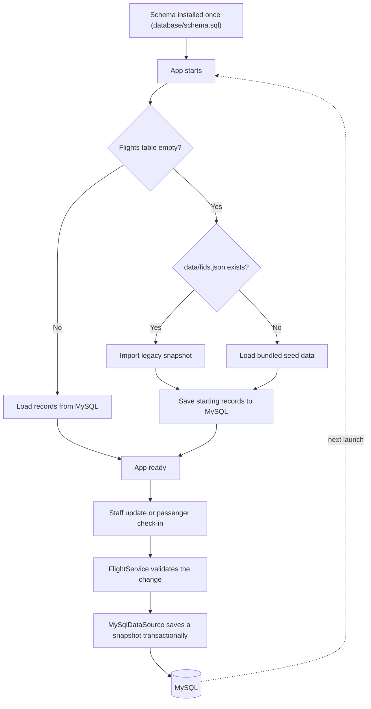

# Wendy — Database & Persistence

**Time:** 1–2 minutes · **Goal:** briefly show how the app reads and saves flight data.

## Show the data flow

- The screen sends actions to the controller and service; it does not run SQL.
- FlightDataSource is the storage contract. MySqlDataSource implements it for the normal MySQL-backed app.
- If MySQL is unavailable, the app falls back to sample data in memory. That session will not save changes.

## Explain what is stored

The database keeps airlines and destinations as shared reference data, with flights pointing to them. Bookings connect passengers to flights and store seat, group, and check-in state. A small app_state record stores when the last snapshot was saved.

When staff changes a gate, delays a flight, adds a flight, or a passenger checks in, FlightService validates the action and saves the updated data to MySQL. The write is transactional. On restart, the app loads those records again and advances flight times based on the saved timestamp.

The undo history and audit log last for the current session; flight and booking data persist.

## First launch

The MySQL tables must already exist. The provided database/schema.sql defines them; the app does not create missing tables automatically. Once the tables exist, an empty flights table is populated from data/fids.json when that legacy file is available, or from the bundled seed data otherwise. Later launches read from MySQL.

## Short talk track

> “The app keeps database access behind FlightDataSource. When someone changes a flight or checks in, FlightService applies the rules and MySqlDataSource saves the updated snapshot. On the next launch, the app reloads the flights and bookings from MySQL. If the database is empty, it imports the old data file or starts with the bundled sample data. The SQL tables are prepared from our schema file.”

**If asked:** The SQL schema needs to be prepared first. The app seeds records into an empty database, but does not create the tables itself.
