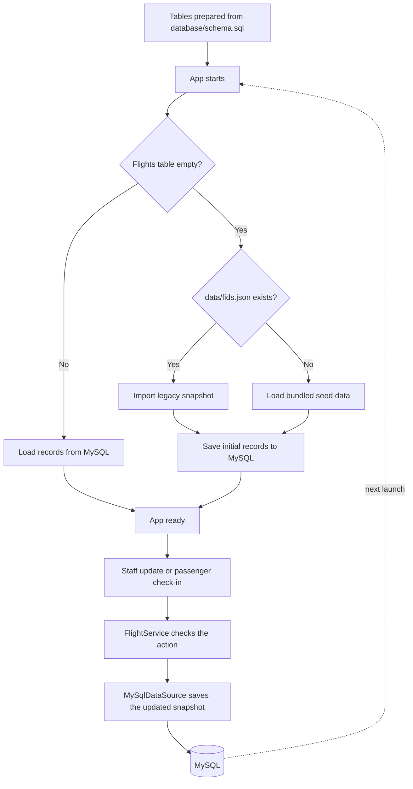

# Wendy — Database & Persistence

**Time:** 2–3 minutes · **Goal:** show how the app loads, updates, and saves its flight and booking data.

## Trace the database flow

Begin with the existing-data branch: if MySQL already contains flights, the app loads the current flights, bookings, and reference data. For a new empty database, it imports the older data/fids.json file when available; otherwise it loads the bundled seed data and saves those records to MySQL.

The storage interface keeps this choice out of the screens. MySqlDataSource is the normal persistent source, FlightRepository supplies in-memory sample data if MySQL is unavailable, and JsonDataSource is used only to read the older JSON snapshot during migration.

**Important setup detail:** database/schema.sql defines the tables, but the app does not create missing MySQL tables automatically. The tables must be prepared before the app can use MySQL.

## Explain what the database stores

Airlines and destinations are shared reference records. Each flight refers to an airline and a destination. Each booking links one passenger to one flight and stores the seat, boarding group, and checked-in flag. The app_state table records when the last data snapshot was saved.

This structure avoids repeating airline and destination details on every flight and keeps passenger booking information connected to the relevant flight. Foreign keys enforce those relationships, and a unique constraint prevents two bookings from taking the same seat on one flight.

## Follow one update through the app

Use a gate change or a check-in as the example:

1. The screen passes the request through FidsController to FlightService.
2. FlightService checks the rules, such as whether the gate is valid or check-in is still open.
3. MySqlDataSource saves the updated flight and booking snapshot in a transaction.
4. The controller receives the change event and refreshes the screen.

For check-in, the booking row’s checked-in state is saved. For a gate change or delay, the flight’s gate, status, estimated time, and reason are saved. The transaction keeps a save together, so a partial write is rolled back if it fails.

**What to show:** if MySQL Workbench is already open, point to the BK7F3A booking row and its checked-in value, or the flight row after a staff change. No SQL query is needed. If the database view is not ready, use the app confirmation and trace the save through the diagram.

When the app opens again, it reads the saved records. It uses the saved timestamp to advance scheduled and estimated times, keeping the board’s times current. Flight and booking data persist; the staff undo history and audit log are session-only.

If MySQL is unavailable, the app can fall back to sample data held in memory. That keeps the demo usable, but changes in that session will not persist.

**Testing note:** the project has 65 JUnit tests for core rules, service behavior, edge cases, notifications, and the JSON data source. There is no dedicated live-MySQL integration test, so demonstrate persistence through a saved row or by reopening the app.

## Short talk track

> “The app separates storage behind FlightDataSource. When staff changes a flight or a passenger checks in, FlightService validates the request and MySqlDataSource saves the updated records to MySQL. On restart, the app loads those flights and bookings again. If the flights table starts empty, it imports the old data file or uses the bundled sample data. The schema file prepares the tables, and the app initializes the records.”

**Close:** “That is how passenger and staff changes reach the database and survive a restart. We are happy to take questions.”
